# Laboratorio de redes en Linux: subnetting, router y captura de tráfico

Práctica evaluable del módulo de Sistemas (ASIR, La Salle). Reúne tres ejercicios sobre administración básica de Linux por terminal, conexión de dos máquinas virtuales con direccionamiento manual y un escenario de tres equipos con subnetting y enrutamiento a través de un router Linux.

## Contenido

- [Resumen](#resumen)
- [Ejercicio 1 – Control básico de Linux vía terminal](#ejercicio-1--control-básico-de-linux-vía-terminal)
- [Ejercicio 2 – Conexión entre máquinas](#ejercicio-2--conexión-entre-máquinas)
- [Ejercicio 3 – Escenario e-commerce virtualizado](#ejercicio-3--escenario-e-commerce-virtualizado)
- [Conclusiones](#conclusiones)

## Resumen

| Ejercicio | Tema | Herramientas |
|---|---|---|
| 1 | Gestión de ficheros y directorios, rutas relativas y absolutas | `touch`, `nano`, `mkdir`, `cp`, `mv`, `rm`, `pwd`, `ls` |
| 2 | Red entre dos VMs sin Internet, IP estática y captura de tráfico | Netplan, `ip a`, `ifconfig`, `ping`, `tcpdump` |
| 3 | Subnetting `/23` → 2 × `/24`, router Linux, rutas y `ip_forward` | Netplan, `sysctl`, `ping`, `mtr`, VMware |

---

## Ejercicio 1 – Control básico de Linux vía terminal

Diez tareas cortas, todas por terminal, alternando ruta relativa y ruta absoluta.

### Tarea A – Crear un fichero con `touch` (ruta relativa)

```bash
touch 2025
ls
```

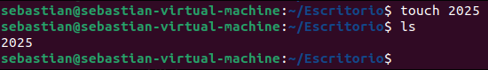

### Tarea B – Crear un fichero sin `touch` (ruta absoluta)

Se crea con el editor `nano`, que genera el fichero al guardar.

```bash
nano /home/sebastian/Escritorio/test
```

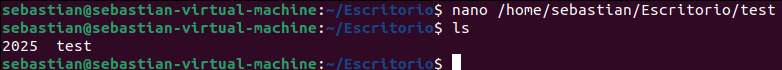

### Tarea C – Crear `work/tools` (ruta absoluta)

```bash
mkdir /home/sebastian/work
mkdir /home/sebastian/work/tools
```

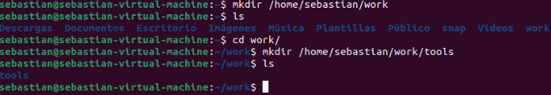

### Tarea D – Copiar `2025` dentro de `tools` (ruta relativa)

```bash
cp Escritorio/2025 work/tools/
```

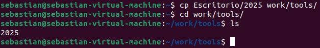

### Tarea E – Mover `test` dentro de `tools` (ruta absoluta)

```bash
mv /home/sebastian/Escritorio/test /home/sebastian/work/tools/
```

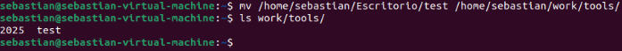

### Tarea F – Desplazarse a `tools` (ruta absoluta)

```bash
cd /home/sebastian/work/tools/
```

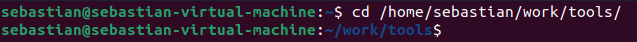

### Tarea G – Comprobar la ruta actual

```bash
pwd
```

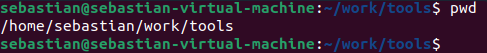

### Tarea H – Comprobar el contenido de `tools`

```bash
ls
```

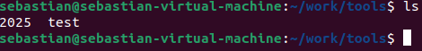

### Tarea I – Mover el fichero copiado a la carpeta personal y renombrarlo (ruta relativa)

```bash
mv 2025 ../../2025_nuevo
```

`../../` sube dos niveles (de `work/tools` a `/home/sebastian`), y `2025_nuevo` es el nuevo nombre.

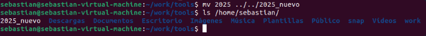

### Tarea J – Borrar todo lo creado

```bash
rm /home/sebastian/Escritorio/2025 /home/sebastian/work/tools/test /home/sebastian/2025_nuevo
rm -r work/
```

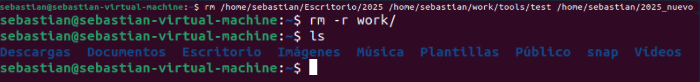


---

## Ejercicio 2 – Conexión entre máquinas

Dos máquinas Ubuntu (un Ubuntu Server importado desde `.ova` y un Ubuntu Desktop propio) conectadas entre sí, sin Internet y con IP estática configurada sin entorno gráfico.

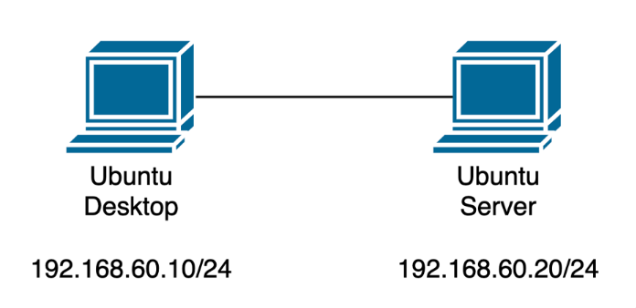

| Máquina        | Interfaz | IP                  | Renderer de Netplan |
| -------------- | -------- | ------------------- | ------------------- |
| Ubuntu Server  | `ens33`  | `192.168.22.129/25` | `networkd`          |
| Ubuntu Desktop | `ens33`  | `192.168.22.192/25` | `NetworkManager`    |

> Nota: las IPs quedaron asignadas al revés respecto al esquema del enunciado (Desktop `.129`, Server `.192`). No afecta a la conectividad, ya que ambas están en la misma red `/25`.

### a) y b) VMs sin Internet

Las máquinas no deben tener Internet. En el servidor se comprueba que no alcanza `8.8.8.8` ni resuelve nombres, y se muestra su IP con `ip a`.

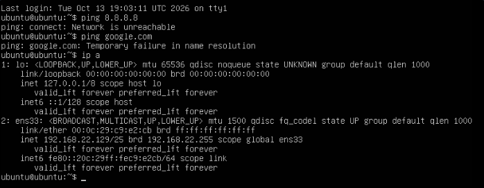

### c) Direccionamiento IP por terminal con Netplan

**Ubuntu Desktop** – fichero `01-network-manager-all.yaml` con la IP añadida manualmente y DHCP desactivado:

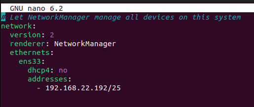

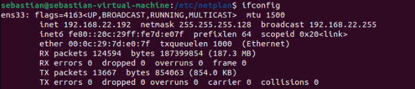

Problema encontrado: al aplicar los cambios, Netplan avisó de que los permisos del fichero eran demasiado abiertos. Se solucionó con:

```bash
sudo chmod 600 /etc/netplan/01-network-manager-all.yaml
```

**Ubuntu Server** – mismo procedimiento sobre el `.yaml`:

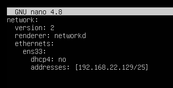

Problema encontrado: el renderer `NetworkManager` no funcionaba porque el servicio no está instalado en esta imagen de Ubuntu Server, así que se usó `networkd`.

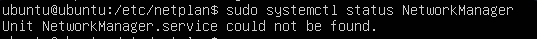

### d) Ping de Desktop a Server y captura con `tcpdump`

En el servidor:

```bash
sudo tcpdump -i ens33
```

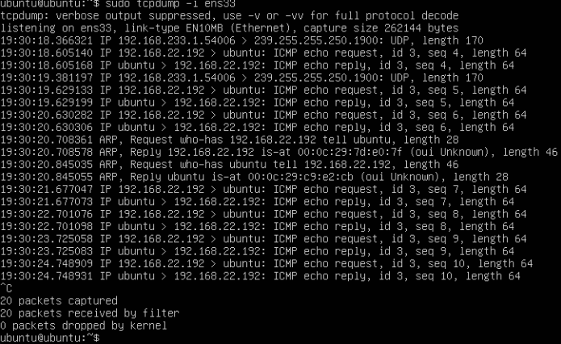

### e) Preguntas

**¿El ping será distinto si se hace de Server a Desktop?**
No. El mecanismo es simétrico: ICMP echo request y echo reply. Repitiendo la captura con el ping en sentido contrario, lo único que cambia es el identificador (`id`) del ICMP y el sentido de origen y destino.

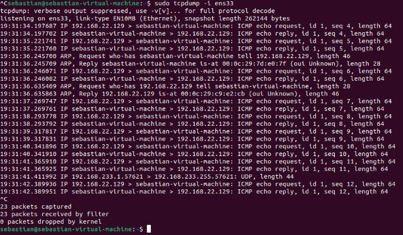

**¿Por qué en `tcpdump` se observan REQUEST y REPLY?**
Porque `ping` usa ICMP: el origen envía un *echo request* y el destino contesta con un *echo reply*, lo que confirma que hay conectividad entre ambos. Antes del primer intercambio aparecen además paquetes ARP, necesarios para resolver la MAC del otro equipo.

**IP de red e IP de broadcast**
Con una máscara `/25` (`255.255.255.128`) y la IP `192.168.22.129`:

- Red: `192.168.22.128`
- Broadcast: `192.168.22.255`

El broadcast se ve en la salida de `ip a`:


**Dos IPs de host más en la misma red**
`192.168.22.130` y `192.168.22.131`.

**¿Cuántos dispositivos como máximo en la red?**
Un `/25` tiene 2⁷ = 128 direcciones, de las que 126 son utilizables (se descuentan red y broadcast). Contando los 2 equipos que ya hay, se pueden añadir **124 más**.

---

## Ejercicio 3 – Escenario e-commerce virtualizado

Infraestructura para una PYME con tres equipos Ubuntu y dos redes internas. PC3 debe comunicarse con PC1 a través de PC2, y solo PC3 tiene acceso a Internet. Bloque reservado: `10.16.208.0` con máscara `255.255.254.0` (`/23`).

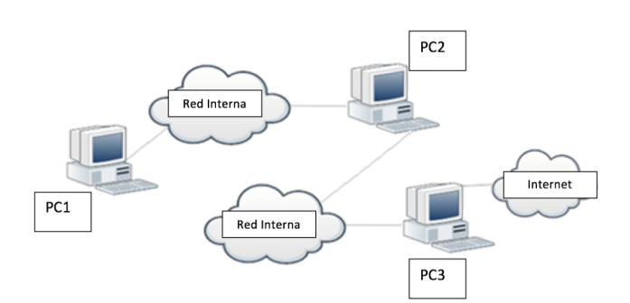

### a) Subnetting

Se necesitan 2 redes, así que se toma 1 bit del campo de host (2¹ = 2) y la máscara pasa de `/23` a `/24` (`255.255.255.0`). Es la división óptima: aprovecha todo el bloque, genera exactamente dos subredes del mismo tamaño y sin solapamientos.

| Red | Rango |
|---|---|
| Red interna 1 | `10.16.208.0/24` |
| Red interna 2 | `10.16.209.0/24` |

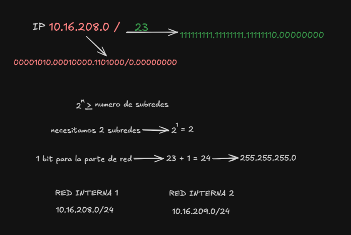

### b) Hosts antes y después de dividir

| Situación | Cálculo | Hosts utilizables |
|---|---|---|
| Red original `/23` | 2⁹ = 512 − 2 | **510** |
| Cada subred `/24` | 2⁸ = 256 − 2 | **254** |
| Las dos subredes | 254 × 2 | **508** |

Se pierden 2 direcciones utilizables en total, porque cada subred reserva su propia dirección de red y su propio broadcast.

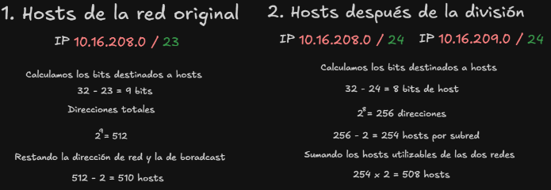

### c) Dibujo lógico

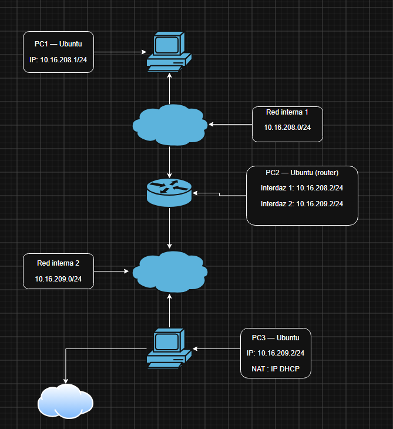

> Nota: en el dibujo, la interfaz 2 de PC2 aparece como `10.16.209.2`. La IP realmente configurada es `10.16.209.1` (ver capturas del apartado d). `10.16.209.2` es la de PC3.

### d) Implementación y tablas de rutas

| Equipo | Interfaz | IP | Notas |
|---|---|---|---|
| PC1 (Ubuntu Server) | `ens33` | `10.16.208.1/24` | Gateway por defecto: `10.16.208.2` (PC2) |
| PC2 (Ubuntu Server, router) | `ens33` | `10.16.208.2/24` | Red interna 1 |
| PC2 | `ens35` | `10.16.209.1/24` | Red interna 2 |
| PC3 (Ubuntu Desktop) | `ens33` | DHCP | Adaptador NAT, da salida a Internet |
| PC3 | `ens37` | `10.16.209.2/24` | Red interna 2. Ruta estática a `10.16.208.0/24` vía `10.16.209.1` |

**PC1.** Se modifica el `.yaml` añadiendo IP y gateway, y se aplica con `sudo netplan apply`.

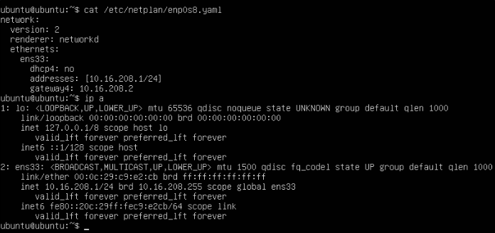

**PC2.** Al venir de la `.ova` solo tenía un adaptador, por lo que se añade un segundo adaptador conectado al LAN segment de la Red interna 2. En el `.yaml`, `ens33` va a la Red interna 1 y `ens35` a la Red interna 2.

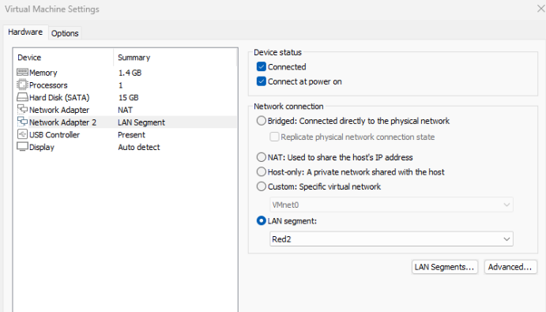

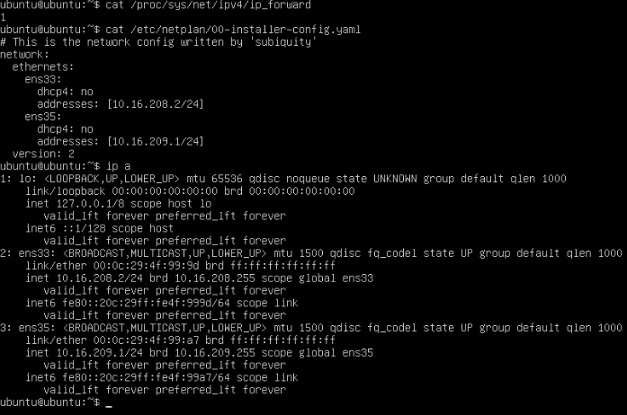

Para que PC2 actúe como router hay que activar el reenvío de paquetes (ver apartado e). Primero se comprobó el valor, que estaba a `0`, se activó y se volvió a leer para verificarlo:

```bash
cat /proc/sys/net/ipv4/ip_forward
sudo sysctl -w net.ipv4.ip_forward=1
cat /proc/sys/net/ipv4/ip_forward
```

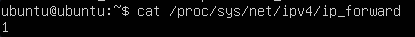

**PC3.** Se añade un segundo adaptador para la Red interna 2 y se mantiene el adaptador NAT. `ens33` (NAT) obtiene IP por DHCP y `ens37` (LAN segment) lleva la IP de la Red interna 2, junto con la ruta estática hacia la Red interna 1 a través de PC2.

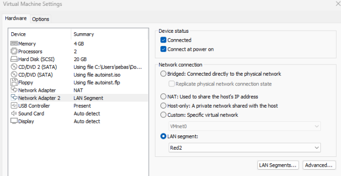

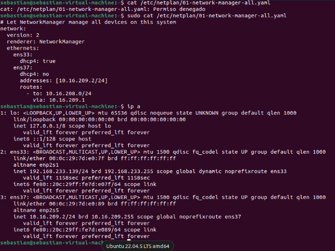

**Pruebas de conectividad.** Desde PC3: salida a Internet (`google.com`), las dos interfaces de PC2 (`10.16.209.1` y `10.16.208.2`) y PC1 (`10.16.208.1`). El `ttl=63` hacia PC1 indica que el paquete ha atravesado un router (PC2).

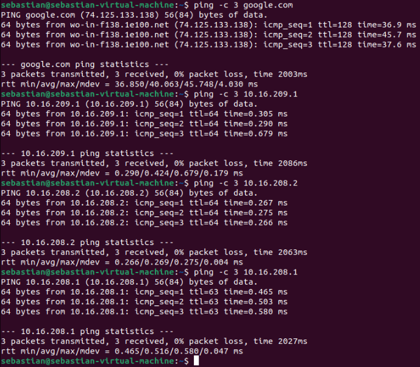

Desde PC1: PC2 por sus dos interfaces, él mismo y PC3 (`ttl=63`, de nuevo un salto por PC2). PC1 no tiene Internet, como pide el enunciado.

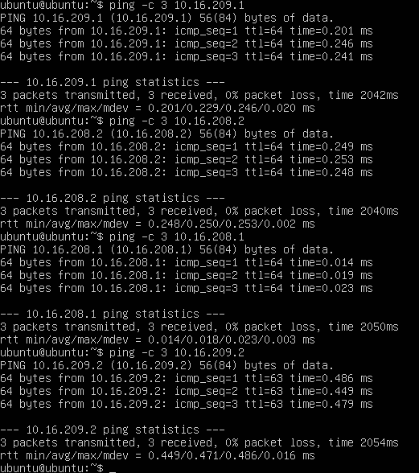

### e) `ip_forwarding`

`ip_forward` es una característica del kernel de Linux que permite a un equipo reenviar paquetes que recibe por una interfaz y que no van dirigidos a él, sacándolos por otra interfaz según su tabla de rutas. Es lo que permite que una máquina Linux funcione como router entre dos redes distintas. No es una vulnerabilidad, sino una funcionalidad necesaria para enrutar.

Por defecto viene desactivada (`0`). Con ella desactivada, el equipo descarta cualquier paquete cuyo destino no sea una de sus propias direcciones IP.

**Activación temporal** (se pierde al reiniciar):

```bash
sudo sysctl -w net.ipv4.ip_forward=1
```

**Activación permanente:** editar `/etc/sysctl.conf`, descomentar la línea `net.ipv4.ip_forward=1` y aplicar los cambios:

```bash
sudo sysctl -p
```

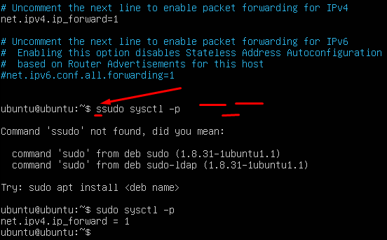

### f) Traceroute con `mtr`

`traceroute` muestra el camino que sigue un paquete desde el origen hasta el destino. PC1 no tiene Internet, así que no se pudo instalar `traceroute` y se usó `mtr`:

```bash
mtr -rn -c 10 10.16.209.2
```

- `-r`: modo informe (salida fija en lugar de interfaz interactiva).
- `-n`: no resuelve nombres, por lo que es más rápido.
- `-c 10`: envía 10 paquetes por salto.

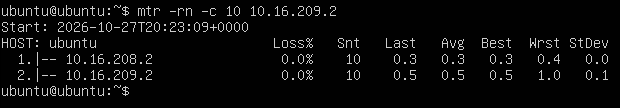

El resultado muestra 2 saltos: el primero es `10.16.208.2` (PC2, el router) y el segundo `10.16.209.2` (PC3, el destino), con 0 % de pérdida. Eso confirma que el tráfico de PC1 a PC3 pasa por PC2.

---

## Conclusiones

- Las rutas relativas dependen del directorio actual; las absolutas funcionan desde cualquier sitio.
- En Netplan hay que ajustar el renderer a lo que tenga instalado la imagen (`networkd` o `NetworkManager`) y los permisos del `.yaml` deben ser `600`.
- Dividir un bloque en subredes reserva red y broadcast en cada una, así que siempre se pierden direcciones utilizables.
- Un router Linux necesita `ip_forward=1` (persistente en `/etc/sysctl.conf`) y rutas coherentes en los extremos.
- El `ttl` de los paquetes y `mtr` sirven para verificar que el tráfico atraviesa el router esperado.
